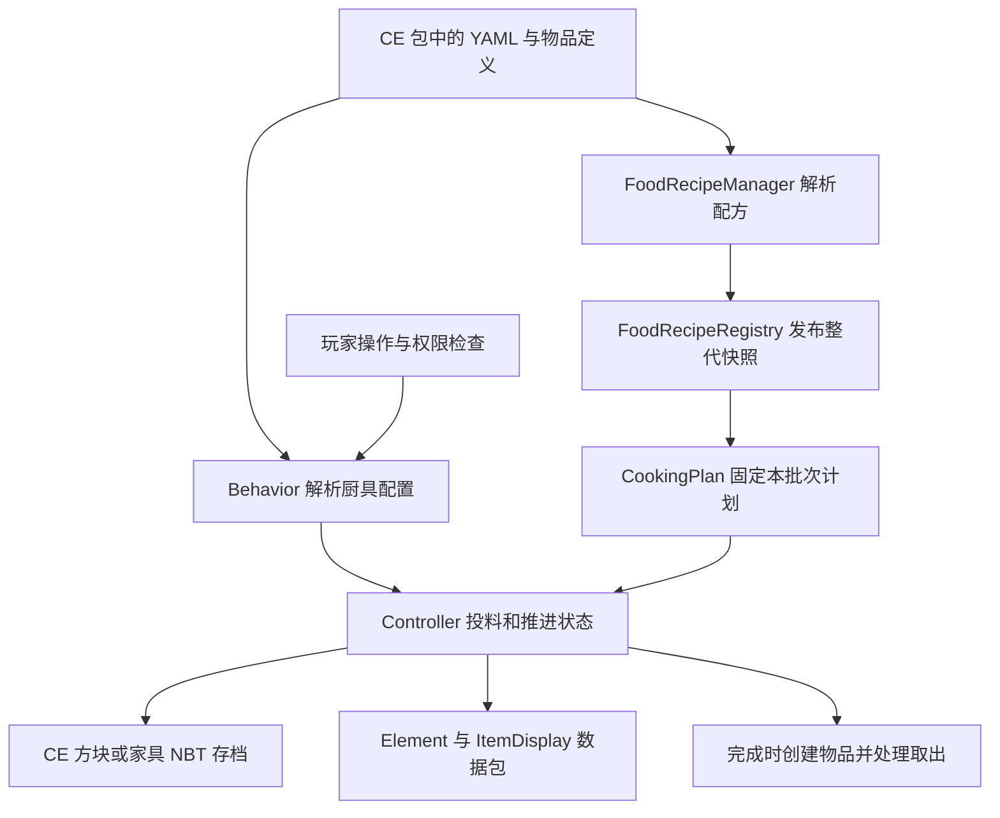

# 森罗烹饪插件开发地图

本说明记录 2026-11-04 的架构追踪与开发结果。原架构段落的行号以基线提交为准；竹筛新增实现见下文。当前验证见 [VALIDATION.md](VALIDATION.md)，不能替代服务器验收。

## 当前基线

- 仓库：`addxiaoyi/KaleidoscopeCookery_Plugin`；本地目录：`D:\qwq\项目\luosen-plugins\luosengchufang`。
- 分支：`main`；提交：`7a2f8427cbbdbd08d6ceef2e4b80ddc8536d1f23`，提交日期 2026-10-07；接手时已用 `git ls-remote --symref origin HEAD` 核对远端默认分支及提交一致。
- 插件版本 `1.3.0`；225 个主 Java 源文件和 9 个 NMS 适配源文件。
- 已克隆、建立 CodeGraph 索引、追踪实现、修复构建并新增竹筛首批实现；尚未提交/推送或安装到服务器。全系列范围和后续阶段见 [IMPLEMENTATION-ROADMAP.md](IMPLEMENTATION-ROADMAP.md)。

## 本次新增：竹筛

独立 `BambooTrayRecipe` 和 `bamboo_tray_recipes` 解析器接入原子配方快照；`BambooTrayBehavior` / `Controller` / `Container` / `Element` 分别负责交互、四槽加工与存档、漏斗桥接及物品展示。每 19 tick 重新匹配晾晒/浸湿配方，保留官方的同向完成保护、反向加工和堆叠产量上限。9 个 NMS 适配均增加原生降雨/天光/水源滴水石锥查询。

`/kcrecipe` 增加竹筛入口，编辑菜单支持原料、标签、产物、产量、模式、时间及增改删。重复 ID、无效配方和缺失标签拒绝加载；失败保留上一代快照。复杂工厂实例同时生成其他内容时拒绝自动删除，避免连带损坏。原有厨具继续使用已有 CookingPlan 规则。

独立示例包及 26 条原版配方见 [竹筛示例](../examples/bamboo-tray/README.md)，2 条茶叶配方需已有食材定义后选装。当前每槽展示一件物品，未对齐官方按数量最多五份的摆放。示例模型引用原版竹材贴图，细绊线外观状态的碰撞不等同模组薄盘。

## 它如何工作

插件把烹饪逻辑接入 CraftEngine（下称 CE）。CE 包提供物品、方块、家具、模型、贴图和玩法 YAML；插件向 CE 注册行为与配方解析器，并负责交互、烹饪进度、存档及客户端展示。`plugin.yml` 强依赖 `CraftEngine`，可选接入 PlaceholderAPI 和 UltimateAdvancementAPI。



启动入口是 `src/main/java/net/kaleidoscope/cookery/plugin/KaleidoscopeCookeryPlugin.java:70`：加载配置、建立保护插件接入、注册配置解析器与监听器、绑定命令、注册方块/物品/家具行为，最后接入可选功能。`onDisable` 关闭编辑队列、配方加载恢复、追踪和展示任务。

源码路径下文均相对 `src/main/java/net/kaleidoscope/cookery/`。

- `plugin/BlockBehaviors.java:45`、`ItemBehaviors.java:19`、`FurnitureBehaviors.java:21`：把 `kaleidoscopecookery:*` 行为 ID 注册到 CE。
- `block/behavior/*Behavior`：读取行为参数，处理放置、交互、保护判定和控制器创建。
- `block/entity/*Controller`：持有原料、进度、结果、批次计划，推进玩法并读写 NBT。
- `block/entity/*Element` 与 `block/entity/render/`：把控制器状态转换为客户端展示；不要把出锅判定移进展示任务。
- 石磨等家具走 `FurnitureController` / `FurnitureTicker`，不能全部按方块实体处理。

## 配方加载与匹配

配方主要来自 CE 资源包，不在插件自己的 `config.yml`。插件配置主要控制控制台语言、成就、菜单外观及统计开关。

`recipe/FoodRecipeManager.java:59` 注册解析器；加载开始时创建待发布状态，等配方、标签、食材分组和容器等阶段完成后一次发布。`FoodRecipeRegistry.java:153` 的 `readSnapshot` 固定一次操作所读的版本；加载失败保留旧快照。新增代码不能在重载过程中把半套配方暴露给玩家。

- `accurate_foods`：蒸笼、石磨、沙威玛，按厨具类型与原料 ID 精准匹配；重复输入索引先注册者优先。加权产物在建立批次计划时抽取一次。
- `pot_flex_foods` / `stock_flex_foods`：炒锅和高汤锅的模糊配方。
- `chopping_board_raws`：砧板原料、刀数、阶段模型和产出规则。
- `teapot_liquid` / `tea_cup` / `teapot_result`：茶壶液体、杯中展示和加工配方，三者有关联校验。
- `pot_food_raw` / `stock_food_raw`、物品标签、等效食材和调味品：控制允许投放什么、哪些原料可以替代，以及哪些投料不参与品质计算。

模糊匹配的实际算法在 `recipe/FlexMatcher.java:27`：

1. 按厨具和汤底过滤；根据配方开关剔除调味品、合并等效食材。
2. 理想配方里的每一种必需食材都必须存在，数量可以不足理想值。
3. 优先选择必需食材种类最多的配方，再比较余弦相似度；同分取先注册的配方。选出的候选还要满足最低分数。
4. 份数为 `max(1, min(实际数量 / 理想数量的整数商))`。
5. 偏差为「每种必需食材与该份数理想用量的绝对差之和 + 杂料数量」。偏差 `0 / 1 / 2 / >=3` 对应 `SUPERB / EXCELLENT / STANDARD / POOR`，食物属性倍率分别为 `1.2 / 0.9 / 0.6 / 0.3`。

例如只考虑理想配方“牛肉 2 + 胡萝卜 1”：投 4+2 得两份极品，投 2+2 得一份优秀，缺胡萝卜则不匹配该菜。品质走 `DishQuality.fromDeviation`，不是旧的 `DishQuality.of(score)` 阈值接口。不要照搬 `FoodRecipeRegistry.java:1094` 的旧注释推断算法。

## 厨具状态与批次计划

`recipe/CookingPlan.java:18` 是不可变批次数据，保存配方 ID、目标时间/次数、已选择的产物 ID、数量、品质、lore、容器及砧板模型，不持有活物品或世界对象。`save/load` 使用带版本的 NBT。损坏计划会被阻塞，不能当成新批次重新抽产物。

- 炒锅：加油、投料，首次有效翻炒冻结计划。每次翻炒有 24 tick 动画窗口，由控制器 tick 判断是否达到次数。出锅后继续受热会烧焦，之后变木炭；停止加热会暂停出锅后的烧焦倒计时。加减原料会清空旧计划与次数。见 `PotController.java:123`、`:228`、`:294`。
- 高汤锅：汤底和原料就绪、盖盖并受热时开始炖煮并冻结计划。断火或开盖暂停，加减原料重新开始批次。见 `StockpotController.java:181`、`:259`。
- 蒸笼：投料时冻结各槽计划；遮盖与热量传递影响加工，断火时每 tick 回退 2 点进度。见 `SteamerController.java:207`、`:251`、`:287`。
- 砧板：放料冻结计划，按刀数推进，最后一刀构建产物。见 `ChoppingBoardController.java:128`。
- 石磨：投料建立计划，累计角度达到目标圈数乘以 360 度后完成；出料事件取消后保留满进度，避免每 tick 重发事件。见 `MillstoneController.java:289`。
- 茶壶：投料冻结计划，先经历固定 200 tick 准备段，再进入配方时间控制的熬煮段；断火暂停。见 `TeapotController.java:185`、`:250`。
- 沙威玛：当前控制器用红石供电和原料状态决定运转；见 `ShawarmaSpitController.java:124`。

炒锅和高汤锅都最多容纳 9 份原料。时间来自服务器 tick，不是离线或现实时间倒计时。冻结计划意味着配方编辑主要影响下一批；物品本身的 CE 定义没有被冻结，完成时仍按当前定义创建物品。产物不存在或计划损坏时保留原料并暂停完成。

存档证据以 `PotController.java:576` 为例：状态、原料、结果、剩余进度、容器、批次计划及阻塞标志一起保存。旧存档无计划时有兼容恢复路径。枚举状态使用 ordinal，调整枚举顺序或 NBT key 必须考虑旧档迁移。

## 菜单编辑如何落盘

入口为 `/kcrecipe` 和 `/kcrecipe edit`，浏览与编辑权限分别是 `kaleidoscopecookery.recipe.browse`、`kaleidoscopecookery.recipe.edit`，两者默认均为 OP。`command/RecipeCommand.java:21` 检查权限后进入 CE GUI。

保存链路：

```text
编辑菜单 -> RecipeEditSaves 防重复提交
         -> RecipeEditService 进入串行异步队列，执行保存时获取 CE 资源操作许可
         -> RecipeFileStore / RecipePatchWriter 验证来源并写回 YAML
         -> FoodRecipeRegistry.atomicUpdate 更新运行时快照
         -> 回到玩家所属线程显示保存结果
```

关键实现：`recipe/edit/RecipeEditService.java:278`、`:622`，`RecipeFileStore.java:411`、`:888`，`RecipePatchWriter.java:26`。

- 编辑现有配方优先写原文件；新文件需找到唯一启用且 namespace 为 `kaleidoscopecookery` 的 CE 包。
- 模板保留 `template` 并使用局部覆盖；工厂实例优先修改可独立定位的参数，必要时在原位置拆分实例。
- 保存前比较加载时的来源、当前文件及模板依赖链；动态模板、状态型参数或来源歧义会拒绝自动保存。
- 写同目录临时文件，刷新到磁盘后优先原子替换；文件系统不支持时退回普通替换。
- 文件写入与运行时更新不是一个可共同回滚的事务。如果写盘成功、热更新失败，界面会提示需要重载；不能把这种情况当作文件未修改。

## 后续开发从哪里改

- 新菜、配方比例、加工时间：先改配套 CE 包中的 YAML。精准配方时间用 `cooking_time`，炒锅用 `stir_fry_count`，石磨用 `rotations`，砧板用 `stage`。
- 新交互或烹饪规则：从对应 `Behavior` 和 `Controller` 切入；展示修改落在 `Element` / `render`。
- 新厨具类型：需要同时考虑行为注册、控制器、展示、配方类型/解析器、菜单以及配套 CE 资源定义。
- 菜单换皮或完全接管：`api/KaleidoscopeCookeryAPI.java:84` 的样式 API 和 `:93` 的 `RecipeMenuHooks`，不必先改所有 GUI。
- 外部插件扩展：`KaleidoscopeCookeryAPI` 已暴露菜刀、拉磨动物、标签、起炒条件、配方、白名单和汤底入口。优先使用这些入口与 `api/event/` 中的可取消事件。
- 跨区域/实体操作：使用 `util/FoliaUtil.java` 的 CE 调度器封装。世界、背包和活物品操作留在所属线程；文件 IO 在编辑队列。
- 取出成品时：先校验/预览、发事件，再提交消耗和产出；份数每次改变都要标脏。`PotController.java:426` 明确处理部分取出后的保存，避免卸载回滚导致重复领取。
- CE 重载会重建方块属性；用 `util/BlockStates.java` 重新解析属性，不直接长期持有旧 Property。

最小配置示例（用于已有完整 CE 森罗包的测试服；本次未部署）：

```yaml
accurate_foods:
  luosen:steamed_potato_demo:
    require: minecraft:potato
    result: minecraft:baked_potato
    cook: steamer
    cooking_time: 100
```

把示例加入目标包的 `configuration/` 下 YAML 后，通过测试服 `/ce reload all` 加载；在满足蒸笼条件时，100 tick 对应 20 TPS 下约 5 秒加工时间。若现有包已注册同一蒸笼原料，应编辑原配方，避免先注册者优先导致此示例不生效。

## 构建与资源现状

`gradle.properties` 指定插件 `1.3.0` 和 CE 编译基线 `26.9.1`。Wrapper 为 Gradle `9.4.0`；主模块使用 Java 21，26.x NMS 模块使用 JDK 25 编译器。`build.gradle` 使用 Shadow 打包所有适配模块，并重定位 AntiGriefLib、bStats。

2026-11-04 首次构建记录（依赖阻塞已于同日修复）：

- `.\gradlew.bat javaToolchains --no-configuration-cache --console=plain`：通过，本机 JDK 21、25 均被识别。
- `.\gradlew.bat build --console=plain`：失败，1 分 36 秒；依赖 `net.momirealms:sparrow-reflection-proxy-scanner:1.1` 无法解析。
- `.\gradlew.bat compileJava --no-configuration-cache --console=plain`：同一依赖失败，8 秒；排除仅由配置缓存造成的失败。
- 当时首个阻塞位于 `build.gradle:86`，尚未进入 Java 编译；修复和当前结果见下文。
- 原始证据保留在本地被忽略的 `build-baseline.log`、`compile-baseline.log`、`toolchains-baseline.log`。

修复只删除了失效的 `sparrow-reflection-proxy-scanner:1.1` 这一条 `compileOnly`，未升级 CE API 或修改玩法源码。官方 Momirealms releases 仓库该版本 POM 返回 404；本项目源码无 scanner 引用。官方 CE `bukkit/proxy/build.gradle.kts` 仅依赖 `sparrow-reflection` 并将其重定位进 CE；实际下载的 CE 26.9.1 proxy JAR 含 `ASMProxyFactory` 和 `ReflectionProxy`，`jdeps` 未发现 scanner 引用。该 JAR 的 SHA-256 为 `e74945e346b93ab5edecda21230cbcd9e608c380b47684803cf819d09e077fb8`，与其官方 Gradle 发布元数据一致。

修复后执行 `.\gradlew.bat build --console=plain`：`BUILD SUCCESSFUL in 3m 2s`，14 个任务执行，主源码、全部 9 个 NMS 模块、Shadow JAR 和 Javadoc JAR 均完成，配置缓存成功保存。日志保留在本地被忽略的 `build-recovery.log`。仍有原有 deprecated/unchecked 提示和 Gradle 10 弃用提示；`test NO-SOURCE` 表示没有执行 Java 测试。

- 插件产物：`build/libs/KaleidoscopeCookeryPlugin-1.3.0.jar`，1,120,666 字节。
- SHA-256：`d83c2790967713dc6d882e0c0a0e7976216debb27d3c92fdddb809a116e962cb`。
- 已检查 JAR 含 9 个 NMS 实现及重定位后的 AntiGriefLib、bStats，未混入 `net/momirealms/`、`com/frengor/`、`org/bstats/` 原包；打包后的 `plugin.yml` 版本为 `1.3.0`。

构建脚本有 9 个 NMS 适配模块。`nms/NmsBridgeProvider.java:37` 按版本选择实现，26.3 复用 26.2，未识别版本抛错；这是源码声明，不能替代各版本服务器启动与玩法实测。

上面的构建记录是添加竹筛前的历史基线。此次已取消 `/src/test/` 忽略并加入 JUnit 5；当前构建、29 项 Java 测试、15 项工具测试及产物哈希见 [VALIDATION.md](VALIDATION.md)。这些本地结果不等于服务器或真人玩家验收。

`Kaleidoscope/` 只跟踪 5 个文件：包元数据、成就文本、菜单图标 YAML、PNG 和 SVG 源文件。完整的厨具/食材定义、配方、模型和贴图不在此次克隆内容中。源码可继续开发，完整玩法联调还需要目标服的 CE 版本与配套资源包。

## 已确认的描述差异和验收边界

- README 称沙威玛“炭火慢烤”，但插件和官方 `ShawarmaSpitBlock` 都由红石启动，不应当作缺少火源判断的复刻缺陷。实际配方差异见 [COOKERY-PARITY.md](COOKERY-PARITY.md)。
- `DishQuality.java` 注释提到效果时长，实际 `DishFoodScaler.java:19` 只缩放饱食度、饱和度；异常会返回原物品且没有日志。
- 菜单保留 CE 原 lore，实际模糊配方成品由 `FlexMatcher.java:192` 设置品质 lore。这是不同路径，不能推断出锅物品也保留原 lore。

首次联调至少验证一条精准配方、一条模糊配方、竹筛加工中重载、区块卸载/恢复、部分取物后恢复、事件取消以及产物被移除后的保料行为。当前已完成本地构建和自动化测试，尚未启动测试服或进行玩家操作。

本地 CodeGraph 索引已建立，并用于符号定位；调用图未覆盖的部分通过直接读源码核实。会话指定的 `C:\Users\l\.codex\scripts\auto-pull-codex-stack.ps1` 在该路径不存在，自动同步未执行。
